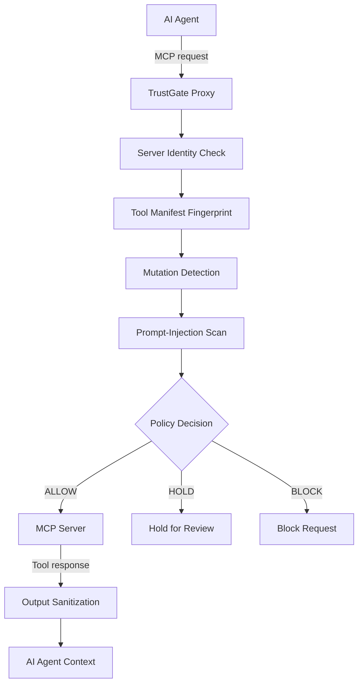

# TrustGate

### A security gateway for Model Context Protocol (MCP)

TrustGate sits between an AI agent and MCP servers to help detect untrusted servers, unexpected tool changes, and prompt-injection content before it enters the agent's context.

### DEMO OUTPUT 

## HOLD


## BLOCK


## ALLOW


## LIVE TERMINAL DASHBOARD


## LIVE WEB DASHBOARD


Built for **MEGATHON26 — Cyber PS2**.

---

## The problem

AI agents often rely on tools exposed by MCP servers. An agent may connect to a server whose identity is misleading, or encounter tool definitions that have changed since they were trusted. Tool descriptions and returned content can also contain prompt-injection instructions.

Without a verification layer, an agent may treat untrusted tool metadata or output as safe input.

## Our solution

TrustGate acts as an inspection and policy layer in the MCP communication path. It applies a set of checks and produces a clear decision:

- **ALLOW** — the request or content passes the configured checks.
- **HOLD** — a change or suspicious condition needs review.
- **BLOCK** — the content or server fails a security check.

### What TrustGate checks

1. **Server identity** — checks server identity and flags names that resemble trusted entries, helping detect typosquatting.
2. **Tool fingerprints** — creates SHA-256 fingerprints for approved tool manifests so later changes can be identified.
3. **Tool mutation** — compares a server's current tool definitions with the approved version and produces a readable diff when they differ.
4. **Prompt-injection scanning** — scans tool descriptions for suspicious instruction patterns, with an optional semantic scanning tier.
5. **Output sanitization** — inspects and sanitizes tool output before it is passed back into the AI agent's context.

## Architecture

The following diagram shows the high-level request and response path.



TrustGate uses an MCP stdio proxy approach to mediate communication with the configured server process.

## Demo flow

The demo exercises the gateway against different server and tool conditions:

| Scenario | What TrustGate demonstrates |
|---|---|
| Untrusted or lookalike server | Identity and typosquatting checks |
| Previously approved tools | SHA-256 manifest fingerprint verification |
| Changed tool definition | Mutation detection and readable diff |
| Suspicious tool description | Prompt-injection scanning |
| Tool response content | Output sanitization before returning content to the agent |

The policy layer reports the outcome as **ALLOW**, **HOLD**, or **BLOCK**. Demo output is illustrative and should not be interpreted as a performance benchmark. 

## Tech stack

| Technology | Purpose |
|---|---|
| Python 3.11+ | Core implementation |
| MCP Python SDK | MCP protocol integration |
| FastMCP | MCP server implementation for testing and demos |
| asyncio and subprocess | Asynchronous process and stdio communication |
| SQLite | Local persistence for trusted state |
| hashlib (SHA-256) | Tool manifest fingerprinting |
| RapidFuzz | Similarity checks for server-name detection |
| difflib | Human-readable comparison of tool definitions |
| Regular expressions and text normalization | Prompt-injection pattern scanning |
| OpenRouter (optional) | Optional semantic scanning tier |
| Rich | Terminal output and presentation |

## Getting started

### Requirements

- Python 3.11 or newer
- Git

### Clone the repository

```bash
git clone https://github.com/VGSAIRAIMA/TrustGate_MEGATHON26_CYBER_PS2.git
cd TrustGate_MEGATHON26_CYBER_PS2
```

### Create and activate a virtual environment

```bash
python -m venv .venv

# macOS / Linux
source .venv/bin/activate

# Windows PowerShell
.venv\Scripts\Activate.ps1
```

### Install dependencies

Use the dependency file provided in the repository, if present:

```bash
pip install -r requirements.txt
```

If the project does not include a requirements file in your checkout, install the dependencies listed in the project configuration / `TECH_STACK.md`.

### Run

Example command for launching the proxy with the calculator demo server:

```bash
python trustgate/main.py run --target "python servers/calculator.py"
```

Run commands from the repository root. Check the CLI help if your local checkout uses a different entry point:

```bash
python trustgate/main.py --help
```

## Project structure

```text
TrustGate/
├── trustgate/
│   ├── proxy/
│   ├── security/
│   ├── mechanisms/
│   ├── storage/
│   ├── policy/
│   └── console/
├── servers/
├── tests/
├── PRD.md
├── TECH_STACK.md
├── DEMO_SCRIPT.md
└── README.md
```

## Security scope

TrustGate focuses on the **MCP tool and data channel**: server identity, tool metadata, and tool output. It does not sandbox MCP server code or replace operating-system-level isolation. A malicious server process may still require separate containment and permission controls.

## Team / event
Team Leader  - V G SAIRAIMA ( SAVEETHA ENGINEERING COLLEGE )

Developed for **MEGATHON26 — Cyber PS2**.

**TrustGate — Verify before trust.**
